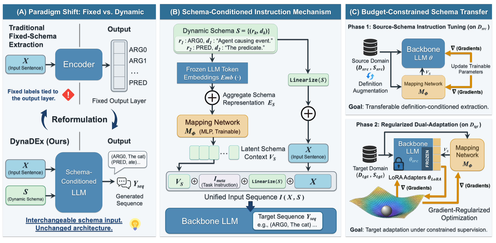

# DynaDEx: Transferable Definition-Conditioned Extraction with Dynamic Schemas


This repository contains the implementation of **DynaDEx** for anonymous review.

<div align="center">
  
</div>

## Introduction

DynaDEx conditions a language model on natural-language schema definitions to extract `(Role Label, Text Span)` pairs. Its two-stage training pipeline learns a source extraction policy and adapts it to target tasks under limited annotation budgets.

### Key Features

- **Dynamic schemas:** Task-specific labels and definitions are supplied as inputs.
- **Schema-Conditioned Instruction Mechanism (SCIM):** A trainable mapper converts schema representations into a latent prefix alongside the visible instructions.
- **Regularized Dual-Adaptation (RDA):** Target adaptation jointly trains a new LoRA adapter and the schema mapper with Gradient-Regularized Optimization (GRO).

## Project Structure

```text
.
|-- preprocessing/             # Data conversion and instruction construction
|-- src/
|   |-- modeling_dynadex.py    # Backbone and schema mapper
|   |-- data.py
|   |-- checkpointing.py
|   |-- training_common.py     # Shared training helpers and GRO
|   |-- train_phase1.py
|   |-- train_phase2.py
|   |-- inference.py
|   |-- evaluate.py
|   |-- run_phase2_matrix.py
|   |-- evaluate_rephrasing.py
|   `-- benchmark_inference.py
|-- DynaDEx_overview.png
|-- requirements.txt
`-- README.md
```

Datasets, schemas, label mappings, and model checkpoints are supplied externally.

## Setup

Use Python 3.12 and a CUDA-compatible PyTorch environment for training.

```bash
conda create -n dynadex python=3.12 -y
conda activate dynadex
python -m pip install -r requirements.txt
```

Run the Bash commands below from the repository root. Replace `/path/to/...` with your local paths. `--base-model` accepts a Hugging Face model ID or a local model directory.

## Usage

### 1. Prepare Data and Instructions

Convert each dataset split separately. For CPB1.0 files with one sentence per line and tokens in `word/POS/BIOES-label` format (`rel` marks the predicate):

```bash
python -m preprocessing.prepare_datasets \
  --format cpb-bioes --language zh \
  --input /path/to/cpb1/train.txt \
  --output /path/to/processed/cpb1_train.json
```

Build source training instructions using an external schema:

```bash
python -m preprocessing.build_instructions \
  --input /path/to/processed/cpb1_train.json \
  --schema /path/to/schemas/cpb1_schema.json \
  --output /path/to/processed/cpb1_train_ins.jsonl \
  --augment-definitions --shuffle-schema --seed 42
```

Prepare source dev and target train/dev/test instructions in the same way, using the corresponding splits and schemas. Omit augmentation and shuffling flags for evaluation splits. Use `--help` for other conversion formats and external label mapping options.

### 2. Phase 1: Source Instruction Tuning

```bash
python -m src.train_phase1 \
  --base-model Qwen/Qwen3-8B \
  --train-file /path/to/processed/cpb1_train_ins.jsonl \
  --dev-file /path/to/processed/cpb1_dev_ins.jsonl \
  --output-dir outputs/phase1 \
  --epochs 2 --learning-rate 2e-5 \
  --per-device-batch-size 4 --gradient-accumulation-steps 32 \
  --latent-length 10 --dtype bfloat16 --seed 42
```

### 3. Phase 2: Target Adaptation

```bash
python -m src.train_phase2 \
  --base-model Qwen/Qwen3-8B \
  --phase1-checkpoint outputs/phase1 \
  --train-file /path/to/processed/target_train_ins.jsonl \
  --dev-file /path/to/processed/target_dev_ins.jsonl \
  --output-dir outputs/phase2/target \
  --maximum-train-samples 2000 \
  --epochs 3 --learning-rate 2e-5 \
  --per-device-batch-size 4 --gradient-accumulation-steps 16 \
  --rho 0.05 --alpha 0.20 \
  --latent-length 10 --dtype bfloat16 --seed 42
```

Keep the base model, latent length, and schema mapper setting consistent across training and inference.

### 4. Inference and Evaluation

```bash
python -m src.inference \
  --base-model Qwen/Qwen3-8B \
  --phase1-checkpoint outputs/phase1 \
  --phase2-checkpoint outputs/phase2/target \
  --input /path/to/processed/target_test_ins.jsonl \
  --output results/target_predictions.json

python -m src.evaluate \
  --gold /path/to/processed/target_test.json \
  --predictions results/target_predictions.json \
  --mode pair --output results/target_metrics.json
```

Omit `--phase2-checkpoint` for zero-shot target transfer with the Phase 1 model.

Evaluation reports micro precision, recall, and F1. `pair` requires exact label and span-text matches after trimming surrounding whitespace. `srl` additionally requires an exact predicate-text match and expects one predicate instance per record. Matching is case-sensitive; scores use a 0–1 scale.

### Additional Experiments

The repository also includes annotation-budget sampling, experiment sweeps, definition-rephrasing evaluation, and inference benchmarking. Run the corresponding module with `--help` for its arguments. Ablations use `--without-schema-mapper`, `--without-gro`, or `--instruction-only`; mapper-disabled runs require separately trained compatible checkpoints.
